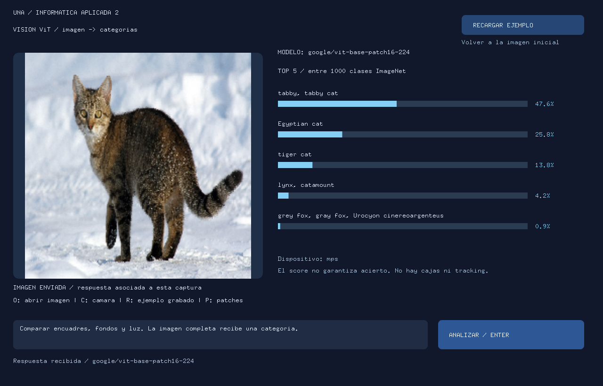
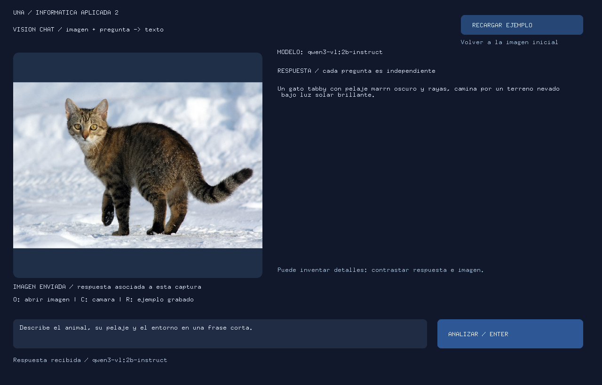

# vision-transformers-models-openFrameworks-stages

Para la clase de código: [del modelo a una interacción en OF](docs/GUIA_CODIGO_OF.md).

Dos ejemplos locales para aprender a construir una interacción a partir de la
respuesta de un modelo. Esta carpeta es la raíz del repositorio: incluye Python,
el addon `ofxLocalAI`, los sketches y el material de clase.

| Ejemplo | Modelo | Entrada → salida | Motor y conexión |
| --- | --- | --- | --- |
| [visionViT](visionViT/README.md) | Google ViT Base, parches 16 × 16 | Imagen → cinco categorías con scores | Python/PyTorch, HTTP/JSON en `127.0.0.1:8768` |
| [visionChat](visionChat/README.md) | Qwen3-VL 2B Instruct | Imagen + pregunta → texto | Ollama, HTTP/JSON en `127.0.0.1:11434` |

OF captura y dibuja; `ofxLocalAI` envía solicitudes sin bloquear el dibujo; cada
motor ejecuta su modelo. ViT clasifica la imagen completa; Qwen responde preguntas
sobre ella. Estos ejemplos no generan imágenes o video ni hacen tracking.

## Los ejemplos en funcionamiento

Capturas de las aplicaciones openFrameworks con **respuestas reales de los modelos
locales**, usando la misma foto de un gato. Se puede probar sin cámara.

### visionViT: imagen → categorías

ViT clasifica la imagen completa y muestra las cinco categorías con mayor score.
En esta captura, la primera es `tabby, tabby cat` (47,6 %). Las barras son hipótesis
sobre la imagen; no señalan objetos ni posiciones.



### visionChat: imagen + pregunta → descripción

Pregunta: **«Describe el animal, su pelaje y el entorno en una frase corta.»**
Qwen3-VL recibe la foto y el texto, y genera la descripción que muestra OF.
La respuesta se revela con una animación de escritura después de recibirla completa.



**Para repetir la prueba:** iniciar el servicio del ejemplo, abrir el sketch,
pulsar **O** y elegir [la foto incluida](assets/screenshots/cat.jpg). En visionChat,
escribir la pregunta en el cuadro de texto. Pulsar **ANALIZAR** para consultar el
modelo. Los resultados pueden variar.

Foto: **Von.grzanka**, [Wikimedia Commons](https://commons.wikimedia.org/wiki/File:Felis_catus-cat_on_snow.jpg),
[CC BY-SA 3.0](https://creativecommons.org/licenses/by-sa/3.0/).
[Créditos, licencia de las capturas y detalles de la prueba](assets/screenshots/CREDITS.md).

## 1. Instalar el entorno y descargar los modelos

Descargar la carpeta completa y ubicarla donde se la vaya a utilizar. Abrir una
terminal **en esta carpeta** y ejecutar el comando del sistema:

| Sistema | Comando |
| --- | --- |
| macOS | `bash install_env_mac.command` |
| Linux | `bash install_env_linux.sh` |
| Windows, CMD | `install_env_windows.cmd` |
| Windows, PowerShell | `.\install_env_windows.cmd` |

Los scripts preparan Python 3.11 mediante uv, instalan Ollama si falta, crean
`.venv-vision`, instalan las bibliotecas y descargan **solamente ViT y Qwen3-VL**.
No hace falta instalar la clase de LLM. En Windows completar el asistente de
Ollama cuando se abra. Si Ollama ya está instalado debe ser versión **0.12.7 o posterior**.

ViT queda en `models/vit-base-patch16-224/`; Qwen queda en el almacenamiento de
Ollama. Se comprueba una inferencia de ViT y se precarga Qwen durante cinco minutos.
Ollama queda iniciado. Si ya existe el mismo modelo en Ollama, se reutiliza.
La primera preparación requiere internet; las consultas posteriores son locales.

No mover `.tools` ni `.venv-vision` entre carpetas o computadoras: contienen rutas
locales. Para cambiar la ubicación, descargar/copiar los fuentes e instalar allí.
Los comandos con `bash` también funcionan si el archivo perdió su permiso de ejecución.

## 2. Iniciar el servicio que necesita el ejemplo

Para **visionViT**, ejecutar y dejar la terminal abierta:

| Sistema | Comando |
| --- | --- |
| macOS | `bash start_vision_mac.command` |
| Linux | `bash start_vision_linux.sh` |
| Windows | `start_vision_windows.cmd` (en PowerShell: `.\start_vision_windows.cmd`) |

Esperar el mensaje de Uvicorn y comprobar [el estado de ViT](http://127.0.0.1:8768/health).
Debe responder `ready: true`. Ctrl+C detiene el servicio. Para elegir CPU,
agregar `--device cpu` al comando de inicio.

Para **visionChat**, mantener Ollama abierto. No necesita el servidor ViT.
Después de reiniciar el equipo, abrir Ollama nuevamente. `ollama list` muestra
los modelos descargados; `ollama ps`, los que están cargados en memoria.

## 3. Copiar los ejemplos a openFrameworks

openFrameworks y el compilador se instalan aparte. Los ejemplos usan OF 0.12.1.

1. Copiar **toda** la carpeta `ofxLocalAI/` a `OF/addons/ofxLocalAI/`.
   Si ya se usó la clase de LLM, actualizar ese addon completo: esta versión agrega
   `classifyImage()` y `ofxVisionImage.h`, manteniendo la API de chat.
2. Copiar `visionViT/` y `visionChat/` a `OF/apps/myApps/`.
3. En Project Generator, importar/actualizar cada proyecto existente. Si muestra
   campos separados: **Project path = `OF/apps/myApps`** y **Project name =
   `visionViT`** o **`visionChat`**. Elegir el addon **ofxLocalAI**.
4. Dejar Additional source paths vacío y pulsar **Update**. El `src/ofApp.cpp`
   generado debe ser el del ejemplo; no crear una plantilla dentro de otra carpeta.
5. Compilar y ejecutar el proyecto generado. En macOS/Linux, desde su carpeta en OF:

```sh
make Release -j4
make RunRelease
```

En Windows, abrir y compilar con el IDE correspondiente a la distribución de OF.
Estos ejemplos no necesitan OSC ni Box2D. La copia que se edita y compila es la
de `OF/apps/myApps`; los cambios aquí deben copiarse allí antes de recompilar.

## 4. Probar y modificar

- **O** carga un JPG/PNG; **C** activa la cámara; **Enter / ANALIZAR** envía una captura.
- **RECARGAR EJEMPLO** vuelve a la imagen incluida y limpia la respuesta.
- En ViT, **P** dibuja una cuadrícula didáctica de parches, no un mapa de atención.
- En Chat, escribir una pregunta y enviar; **Esc** sale del editor para usar los atajos.
  La escritura progresiva se anima después de recibir la respuesta completa.
- **R** muestra datos de ejemplo marcados *sin inferencia*; no comprueba la conexión.

Modificar `response()` en cada `src/ofApp.cpp` para transformar el resultado en
una interacción; modificar `draw()` para cambiar su apariencia. La dirección del
servicio y la cámara están en `bin/data/connection.json` de cada sketch.

## Modelos, tamaño y requisitos locales

| Modelo | Pesos en disco | RAM total orientativa |
| --- | --- | --- |
| `google/vit-base-patch16-224` (FP32) | 346 MB | 8 GB como punto de partida |
| `qwen3-vl:2b-instruct` (Q4_K_M) | 1,89 GB | 8 GB con poco margen; 16 GB recomendados |

Los pesos suman aproximadamente **2,24 GB**, medidos localmente el 5/10/2026.
El tamaño descargado no equivale al consumo de memoria durante la inferencia.
Las cifras de RAM son estimaciones para trabajar con un modelo a la vez, no
mínimos comprobados en equipos de 8 GB. Prever **15 GB libres en CPU/macOS** o
**25 GB con PyTorch CUDA**, además de OF y el compilador.

- **macOS 14 o posterior:** Apple Silicon puede usar Metal/MPS; Intel puede usar CPU.
- **Windows 10 22H2/11 o Linux de 64 bits:** CPU; NVIDIA compatible puede usar CUDA.
- **GPU opcional:** ViT selecciona CUDA/MPS/CPU según disponibilidad; Ollama decide
  por separado dónde ejecutar Qwen. CPU implica más espera.
- El instalador usa Python 3.11, Torch 2.8.0 (2.2.2 en macOS Intel) y Transformers
  4.57.6. Windows/Linux usan ruedas CUDA 12.8 si se encuentra `nvidia-smi`, CPU en
  otro caso. La disponibilidad real depende del driver y de PyTorch.

Más opciones de dispositivo en [la guía técnica](vision/README.md#gpu-y-cpu).
Referencias: [ViT de Google](https://huggingface.co/google/vit-base-patch16-224),
[Qwen3-VL en Ollama](https://ollama.com/library/qwen3-vl:2b-instruct),
[Ollama macOS](https://docs.ollama.com/macos), [Windows](https://docs.ollama.com/windows)
y [GPU](https://docs.ollama.com/gpu). Ambos modelos tienen pesos con licencia Apache 2.0;
no requieren API key ni pago por consulta local.

## Código y material de clase

| Carpeta o archivo | Para qué sirve |
| --- | --- |
| `vision/` | Descarga, preprocesamiento, ViT, servidor HTTP y cliente Python |
| `vision/ollama_runtime.py` | Encontrar/iniciar Ollama y consultar su API local |
| `setup_vision.py`, `scripts/`, `install_env_*` | Preparar el entorno de esta clase |
| `start_vision_*` | Arrancar el servidor de ViT |
| `ofxLocalAI/` | Addon completo para copiar a OF |
| `visionViT/`, `visionChat/` | Sketches completos con imágenes y configuración |
| `tests/`, `tools/` | Comprobaciones de contratos e instalación |

- [Guía técnica y controles](vision/README.md).
- [Guía breve para explicar y modificar el código OF](docs/GUIA_CODIGO_OF.md).
- [GIF de convolución](convolucion_3x3.gif), [video](convolucion_3x3.mp4) y `assets/`.
- [Registro de validación](docs/VALIDACION.md).

El GIF se incluye para incorporarlo a una presentación. Para enseñar la instalación actual,
usar los comandos de este README; ya no se agrega `--vision` al instalador.

### Comprobaciones para desarrollo

Después de instalar (en Windows cambiar el Python por `.venv-vision\Scripts\python.exe`):

```sh
.venv-vision/bin/python -m pip install -r requirements-dev.txt
.venv-vision/bin/python -m pytest -q
# macOS, comprobación de sintaxis C++ contra el SDK instalado:
.venv-vision/bin/python tools/check_of_headers.py /ruta/a/of_v0.12.1_osx_release
```

`.gitignore` excluye pesos, entornos, cachés y compilados. Las imágenes de ejemplo,
la configuración y los materiales de clase sí forman parte de la entrega.
